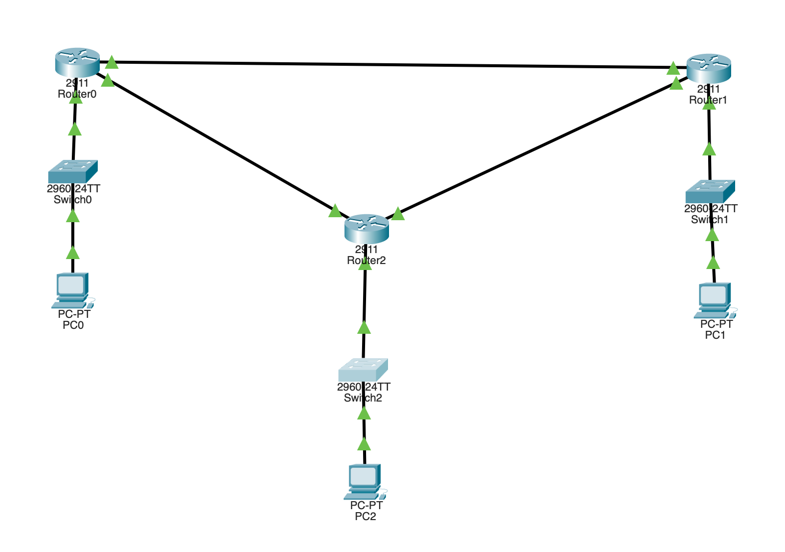

# basic-ospf-lab
CCNA 200-301 OSPF Multi-Router dynamic routing lab in Cisco Packet Tracer

# 🌐 Laboratoire de Routage OSPF Multi-Routeurs (CCNA 200-301)

## 📌 Objectif du projet
Mise en place d'une topologie réseau interconnectée sous **Cisco Packet Tracer**. L'objectif est de configurer le routage dynamique **OSPF (Area 0)** entre trois routeurs pour assurer la communication, la redondance et le routage automatique entre différents sous-réseaux locaux (LAN).

## 🗺️ Topologie Réseau
- **3 Routeurs (Cisco 2911)** interconnectés en triangle pour garantir une haute disponibilité et tester la convergence du protocole OSPF.
- **3 Switches (2960)** et **3 PC** pour simuler les différents segments réseau / départements.
- Fichier Packet Tracer disponible dans le dépôt : [Télécharger le fichier .pkt du laboratoire](/TP-routage-ospf-simple.pkt)

## 🛠️ Technologies & Protocoles Utilisés
- **Routage Dynamique :** OSPFv2 (Process ID 1, Area 0)
- **Adressage IPv4 & Subnetting**
- **Encapsulation & Interfaces (GigabitEthernet)**

## 📂 Organisation du Dépôt
- `configs/` : Contient les fichiers de configuration brute (running-config) extraits de chaque routeur :
  - [Configuration de Router0](./configs/Router0.cfg)
  - [Configuration de Router1](./configs/Router1.cfg)
  - [Configurartion de Router2](./configs/Router2.cfg)

## 🔍 Validation
- Test de connectivité validé par `ping` de bout en bout entre les différents ordinateurs (ex: PC0 vers PC2).
- Vérification des routes apprises dynamiquement via la commande `show ip route ospf`.

---
*Projet réalisé dans le cadre de ma montée en compétences et de ma préparation à la certification Cisco CCNA 200-301 (Profil NetDevOps).*
